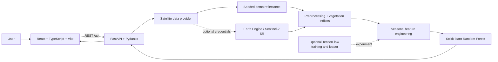

# AgriVision AI

### Satellite intelligence for crop yield forecasting

AgriVision AI is a full-stack geospatial analytics demo showing how satellite reflectance, vegetation indices, and machine learning can be combined in a crop-yield forecasting workflow. Choose a region, crop, season, and cloud threshold; inspect vegetation trends on a map and charts; then run a yield estimate with model factors and evaluation details.

> **Data integrity:** The default experience uses deterministic **DEMO DATA**. It does not represent actual Sentinel-2 observations, farm measurements, or validated agricultural forecasts. Demo yield labels are synthetic. Regression metrics are calculated from a seeded synthetic holdout and must not be interpreted as real-world model performance. The resume reference's “89% accuracy” is not claimed here.

## Product overview

- **Explore a region:** choose a sample centroid in Telangana, Punjab, Maharashtra, or Karnataka, or click the map to position an analysis point. A point buffer is illustrative; it is not a surveyed farm boundary.
- **Configure an analysis:** select Rice, Wheat, Maize, Cotton, or Soybean; set dates and a cloud threshold.
- **Analyze vegetation:** review NDVI, EVI, and NDWI seasonal charts, index summaries, and a Sentinel-2 NDVI map layer when Earth Engine is active.
- **Estimate yield:** run a Random Forest regression demo and review the output range, relative feature importance, and model evaluation.
- **Inspect the workflow:** follow data from Sentinel-2 inputs through vegetation features to the forecast.

The interface labels demo imagery and predictions. Feature importance describes how the model uses inputs; it does not establish cause and effect. The displayed prediction range is tree-to-tree spread, not calibrated uncertainty.

## Architecture



The frontend uses React, TypeScript, responsive CSS, Recharts, and Leaflet. The API and data/model services are Python-based. The current demo prediction uses the Scikit-learn Random Forest; the optional TensorFlow script is a separate experiment and is not used by the dashboard.

## Satellite data and vegetation indices

The Google Earth Engine adapter targets `COPERNICUS/S2_SR_HARMONIZED`. It filters scenes by date, a 5 km buffer around the selected point, and `CLOUDY_PIXEL_PERCENTAGE`; masks saturated, cloud, shadow, cirrus, and snow classes using Sentinel-2 SCL; then summarizes reflectance and vegetation indices. With GEE active, Leaflet can display a temporary NDVI composite layer. The default demo provider generates repeatable sample reflectance and index time series instead.

| Input | Sentinel-2 band |
| --- | --- |
| Blue | B2 |
| Green | B3 |
| Red | B4 |
| NIR | B8 |

The shared vegetation-index service implements:

- **NDVI** = `(NIR - Red) / (NIR + Red)`
- **EVI** = `2.5 × (NIR - Red) / (NIR + 6 × Red - 7.5 × Blue + 1)`
- **SAVI** = `(1 + L) × (NIR - Red) / (NIR + Red + L)`, with `L = 0.5` by default
- **NDWI** = `(Green - NIR) / (Green + NIR)`

Index values are vegetation indicators, not direct measurements of crop yield, plant disease, or field condition. Demo sequences exercise the feature pipeline but are not raster satellite images.

## Yield model and evaluation

The baseline is a seeded Scikit-learn `RandomForestRegressor`. It trains on 500 generated rows and computes MAE, RMSE, and R² from a seeded 80/20 holdout at application startup. The model-performance page shows a sample of actual-versus-predicted holdout rows and relative feature importance. These are synthetic engineering checks, not scientific validation.

Features include seasonal index statistics and reflectance summaries, along with crop and season inputs. The prediction unit is **tons/hectare**. Demo yield targets are generated from a fixed formula with seeded noise; they are not observed yields. The holdout uses a random split, not a spatial or temporal validation design.

An optional, small TensorFlow dense regressor can be trained using the same generated dataset. No TensorFlow model is shipped or used by the dashboard.

## Repository layout

```text
backend/
  app/
    api/             FastAPI routes
    config/          Environment configuration
    gee/             Provider interface, demo provider, Earth Engine adapter
    ml/              Random Forest, TensorFlow adapter, training scripts
    preprocessing/   Vegetation indices and summaries
    schemas/         Pydantic request validation
  tests/             Backend API and index tests
frontend/
  src/
    charts/          Lazy-loaded Recharts visualizations
    maps/            Leaflet map
    pages/           Dashboard and analysis views
    services/        API client and frontend tests
    types.ts         Frontend data types
docker-compose.yml
.env.example
README.md
```

## Run locally

Requirements: Python 3.10 or newer and Node.js 20 or newer.

1. **Start the backend** in one terminal:

   ```powershell
   cd backend
   python -m venv .venv
   .venv\Scripts\Activate.ps1
   python -m pip install -r requirements.txt
   python -m uvicorn app.main:app --reload --port 8000
   ```

2. **Start the frontend** in a second terminal:

   ```powershell
   cd frontend
   npm ci
   npm run dev
   ```

Open the Vite URL printed in the frontend terminal (normally `http://localhost:5173`). Vite proxies `/api` to `http://localhost:8000`. FastAPI's interactive API docs are at `http://localhost:8000/docs`.

### Docker Compose

With Docker installed, run from the repository root:

```bash
docker compose up --build
```

Open `http://localhost:8080`. Compose defaults to demo mode. Earth Engine in a container requires the optional Python package plus a credential file mounted into the backend container and referenced by `GOOGLE_APPLICATION_CREDENTIALS`.

## Demo mode and Earth Engine setup

The no-credential default is:

```dotenv
DATA_PROVIDER=demo
```

To try the Earth Engine adapter:

1. Install the optional dependency in the backend environment: `python -m pip install earthengine-api`.
2. Set `DATA_PROVIDER=gee` and `GOOGLE_EARTH_ENGINE_PROJECT` in the repository-root `.env` file (start from `.env.example`).
3. Authenticate with Earth Engine using credentials configured for your project. For local interactive authentication, the Earth Engine CLI provides `earthengine authenticate`.
4. Restart FastAPI and check `GET /api/health` for the selected provider.

If Earth Engine initialization fails, the API falls back to the demo provider and returns a fallback reason. If initialization succeeds but a query has no matching scenes or usable pixels, the API returns a human-readable error. The yield model remains trained on synthetic targets even when satellite features come from GEE.

Never commit `.env` files, service-account keys, or other credentials. `.env.example` lists placeholders for Earth Engine project/credentials, provider mode, model path, API URL, and CORS origins. The current UI uses relative `/api` requests through the Vite or Nginx proxy.

## API reference

All endpoints are prefixed with `/api`.

| Method | Endpoint | Purpose |
| --- | --- | --- |
| `GET` | `/health` | API status, selected provider, and initialization fallback reason |
| `GET` | `/crops` | Configured crop names |
| `POST` | `/satellite/search` | Search the configured provider for the selected point and period |
| `POST` | `/satellite/analyze` | Return acquisition summary, vegetation series, and seasonal features |
| `POST` | `/features/extract` | Return extracted features and feature names |
| `POST` | `/predict-yield` | Return demo yield forecast, range, factors, and evaluation metadata |
| `GET` | `/model/info` | Model name, version, feature list, and training-data description |
| `GET` | `/model/metrics` | Computed synthetic holdout metrics and sample comparison rows |
| `GET` | `/model/features` | Random Forest feature importance |
| `GET` | `/demo/sample` | Example analysis and prediction from the configured provider |

Analysis requests include latitude, longitude, region label, crop, start/end dates, and cloud threshold. Pydantic validates coordinates, crop choice, date order and span, and cloud threshold.

## Train the demo models

Run these commands from `backend/`.

```powershell
python -m app.ml.train
```

This saves a Random Forest trained on seeded synthetic data under `models/`. To run the optional TensorFlow experiment, install TensorFlow separately and run:

```powershell
python -m app.ml.train_tensorflow
```

Both scripts use generated targets. Replace them with geographically and temporally aligned ground-truth yields before making agricultural claims. Evaluate with held-out regions and seasons to reduce spatial and temporal leakage.

## Tests

Backend tests:

```powershell
cd backend
python -m pytest -q
```

Frontend API-client tests and production build:

```powershell
cd frontend
npm test
npm run build
```

## Limitations and next steps

- Demo regions are illustrative centroids. Clicking the map selects a point; polygon drawing and farm-boundary validation are not implemented.
- Demo mode does not fetch satellite scenes or produce actual raster imagery. The NDVI map overlay is available from the configured Earth Engine provider.
- The yield model is trained on synthetic targets and has no real-world validation. Its regression metrics and feature importance must not guide farming decisions.
- Tree-to-tree spread is not calibrated uncertainty. No causal conclusions follow from the feature-importance chart.
- Production deployment needs reliable ground-truth yields, spatial/temporal validation, calibrated uncertainty, caching/background jobs, monitoring, authentication, and deployment-specific security review.
